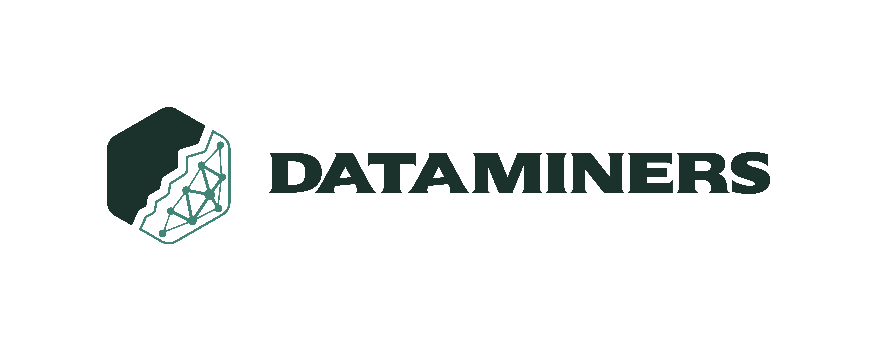

  <picture>
    <source media="(prefers-color-scheme: dark)" srcset="assets/banner-dark.png">
    
  </picture>

<h1 align="center">Dataminers</h1>

<h3 align="center">Del dato crudo al software que funciona.</h3>

  Estudio de software de iteración rápida. Armamos pruebas de concepto, automatizamos procesos con AI y llevamos a producción lo que demuestra valor.

 

<table>
  <tr>
    <td width="33%" valign="top">
      <h4>Pruebas de concepto</h4>
      Validamos la idea con un prototipo chico antes de invertir en producto.
    </td>
    <td width="33%" valign="top">
      <h4>Procesos con AI</h4>
      Automatizamos lo repetitivo y dejamos claro qué hace cada paso.
    </td>
    <td width="33%" valign="top">
      <h4>Iteración a producto</h4>
      Lo que funciona pasa a producción. Lo que no, se descarta a tiempo.
    </td>
  </tr>
</table>

## Proyectos

| Repositorio | Qué es |
| --- | --- |
| [`dataminers-site`](https://github.com/dataminers-iti/dataminers-site) | Sitio institucional ([dataminers.lat](https://dataminers.lat)) |

## Contacto

[dataminers.lat](https://dataminers.lat/#contacto)
